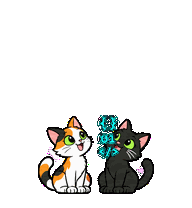

# Nina e Meg

Uma gata tricolor e uma gata preta correm atrás de códigos turquesa que desviam das patadas.

## Adotar no ChatGPT

[Adote a dupla pelo link público](https://chatgpt.com/s/sharepet_6aefb76ade7c81918a84299f883e7843).

## Instalar no aplicativo Codex para computador

Baixe o ZIP do repositório e extraia. Copie a pasta interna `nina-e-meg` (a que contém `pet.json` e `spritesheet.webp`) para a pasta `pets` do Codex. Crie a pasta `pets` se necessário.

- Windows: abra `%USERPROFILE%\.codex` pelo Explorador de Arquivos.
- macOS/Linux: abra `~/.codex` no gerenciador de arquivos.
- Se você configurou `CODEX_HOME`, use esse diretório no lugar de `.codex`.

O caminho resultante deve terminar em `pets/nina-e-meg/pet.json`. Reabra o aplicativo e selecione **Nina e Meg** no seletor de mascotes, em versões que ofereçam mascotes personalizados. Para remover a instalação manual, exclua somente a pasta `pets/nina-e-meg`.

O pacote local inclui as nove animações principais em WebP transparente. A versão compartilhada pelo ChatGPT também acompanha o cursor em dezesseis direções. A duração da brincadeira no GIF é própria da prévia.
